# ABS Control

ABS Control is the operating engine for a property developer's management framework: Government
Affairs, Planning Approvals and Project Coordination, plus the project management function. It
was built for ABS Developers, whose framework document sets out rules such as "submission is not
authorization" and "no change to the baseline without written approval". On paper those rules
depend on people remembering them. Here every register, control, phase gate and KPI in the
document is live data, and the server enforces the rules.

I built it end to end: the register schema, the rules engine, the RAG and KPI calculations, the
alert sweep, the role permissions, the printable CEO reports, the zero-build front end and two
storage back ends. It has no npm dependencies and no build step; it runs on Node's built-in
SQLite.

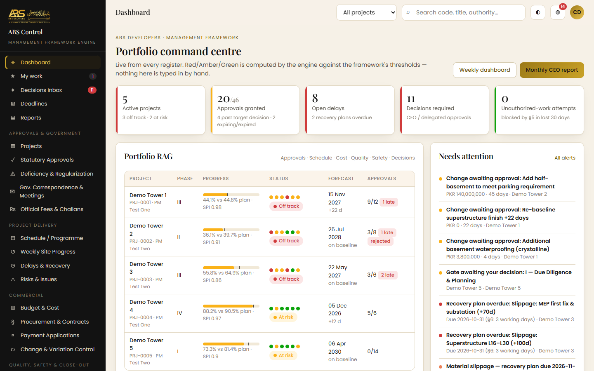

## What it does

**For the CEO**
- Portfolio command centre: active projects, approvals granted, open delays, decisions
  required and blocked unauthorised-work attempts, with a RAG row per project
- Decisions inbox: change requests, submitted phase gates, escalated risks and rejected
  approvals that need a CEO decision
- Phase-gate approval: a project moves to the next phase only when the CEO approves its gate
- Printable weekly coordination dashboard, monthly CEO report and per-project report, all
  generated from the registers at the moment they are opened

**For the Chief Coordinator and the approvals team**
- Statutory approvals and NOCs per authority (LDA, TEPA, WASA, LESCO, SNGPL, EPA Punjab,
  Rescue 1122, CAA and others), from Not Started through Submitted, Observations and
  Resubmitted to Granted, Rejected or Expired
- Deficiency and regularisation register, government correspondence and meetings, and official
  fees and challans
- An approval library of 16 templates that can be applied to a new project in one click
- A deadlines calendar of decision targets, expiries and follow-ups

**For project managers and site teams**
- A Gantt per project (baseline bar, forecast or actual overlay, critical path, milestones) and
  weekly site reports that build the S-curve
- Delays and recovery plans, risks and issues, budget lines, contracts and packages, payment
  applications, and change and variation control
- Inspections and tests, non-conformances, safety records, snags, close-out items, documents,
  transmittals, meetings and actions
- "My work": everything assigned to the signed-in person that is still open

**For the administrator**
- Users and access, a role-by-register permission matrix (read, create, update, delete,
  approve), thresholds and rules, the approval library and the audit log

## The rules the engine enforces

Each rule lives in `beforeSave` in `lib/engine.js`. A request that breaks one gets a 409 or 403
with the framework clause in the message, and nothing is saved.

| Framework clause | Rule in the system |
|---|---|
| §4.4 Written confirmation | An approval cannot be set to Granted without the authority's reference number, issue date and the uploaded letter |
| §5 Submission is not authorization | An activity linked to approvals cannot start unless each one is Granted, unexpired and its conditions acknowledged by site. The attempt is blocked, logged and sent to the CEO and Chief Coordinator |
| §5 Expiry | NOCs and permits raise alerts at 90, 60 and 30 days, then expire automatically, which blocks the linked site work again |
| §6 Recovery plan | Material slippage opens a Delay with a recovery-plan deadline of 3 working days (weekend and holiday aware); an overdue plan goes to the CEO |
| §14 Phase gates | The phase field cannot be edited; it advances only when the gate checklist is complete, submitted and approved by the CEO. Approved gates are permanent |
| §15 Variations | A change cannot be marked Implemented unless it was Approved first, and an approved change cannot be altered |
| §16 Baselines | Locked baseline dates and budget change only through an Approved Change Request; scope and baseline changes, and anything above the PM's delegated limit, need the CEO |
| §16 Decision log | A meeting cannot be closed while any action lacks an owner or a due date |
| §4.10 Lawful conduct | A fee paid to an authority needs an official challan number and a bank receipt before it can be marked Paid |
| Payments | Certified cannot exceed verified; only a Certified application can be marked Paid |

## How the numbers are computed

Nothing on the dashboard is typed in. `projectMetrics()` and `kpis()` in `lib/engine.js` compute
it from the registers on every request.

- **Schedule.** Each activity has a weight, a baseline and a percent complete. Planned percent is
  interpolated from the baseline dates, earned percent is the weighted progress, and SPI is
  earned over planned. Schedule is Green at SPI 0.95 or above, and Red below 0.85 or more than
  30 days late.
- **Slippage.** An unfinished activity past its forecast finish slips one day per day. A slip of
  7 days, or 1 day on the critical path, counts as material and opens a Delay automatically.
- **Cost.** Forecast final cost over budget: Green up to 1.00, Amber up to 1.05, Red above.
- **Approvals, quality, safety, decisions.** Red for a rejection, an expiry or a decision more
  than 14 days late; for a Critical NCR or an overdue Major one; for a High or Lost Time
  incident in 30 days; or for more than 3 open CEO decisions. The project's overall RAG is the
  worst of the six.
- **KPIs.** Two scorecards from the framework: §8 Approvals and coordination (approval tracking,
  submission readiness, observation closure, regularisation, SPI, delay escalation, records
  compliance, close-out) and §17 Project management (milestone adherence, schedule variance,
  cost performance, procurement, change control, quality closure, safety, approval readiness).
- **Alert sweep.** At most once an hour, and after any settings change, `sweep()` expires
  approvals, opens delays and raises deduplicated alerts for expiries, overdue decisions,
  overdue recovery plans, actions and NCRs, authority follow-ups, packages due on site within 14
  days, expiring warranties, submitted gates and change requests. Alerts that no longer apply
  are resolved.

**Data model.** `lib/schema.js` is the single source of truth: 23 registers, each with its
fields, status list, title field and group, plus 14 roles, the 4 lifecycle phases with their
gate checklists, and the default permissions. The API, forms, tables, CSV import and export,
search and reports are all driven from it, so adding a field is a one-line change.

**API.** `/api/r/:entity` (list, get, create, update, delete, bulk), `/api/export/:entity` and
`/api/import/:entity` (CSV), `/api/portfolio`, `/api/kpis`, `/api/inbox`, `/api/mywork`,
`/api/calendar`, `/api/scurve/:id`, `/api/search`, `/api/notifications`, `/api/files`, admin
routes for users, permissions, settings, templates and the audit log, and `/report/:kind` for
the printable reports.

## Stack

| Layer | Choice |
|---|---|
| Server | Node.js 22.5+, the built-in `http` module, no npm dependencies |
| Storage | `node:sqlite` with a write-through in-memory cache; an in-memory store for the hosted demo |
| Auth | scrypt password hashes, session cookies, HMAC-signed stateless sessions on serverless |
| Front end | One vanilla JavaScript single-page app with a hash router and hand-written CSS, light and dark |
| Reports | Server-rendered HTML, printed to PDF from the browser |
| Hosting | `node server.js` on a VPS, the included `Dockerfile`, or Vercel through `api/index.js` |

## Engineering

- About 3,360 lines across 15 source files, with no third-party packages to audit or update
- Every write goes through one `save()` path: type coercion and validation, permission and
  project-scope checks, the framework rules, then an audit-log entry with the changed fields
- One storage interface behind `lib/db.js`, so the engine, API and UI are identical on SQLite
  and in memory
- There are no automated tests or CI in this repository yet

## Screenshots

| | |
|---|---|
| 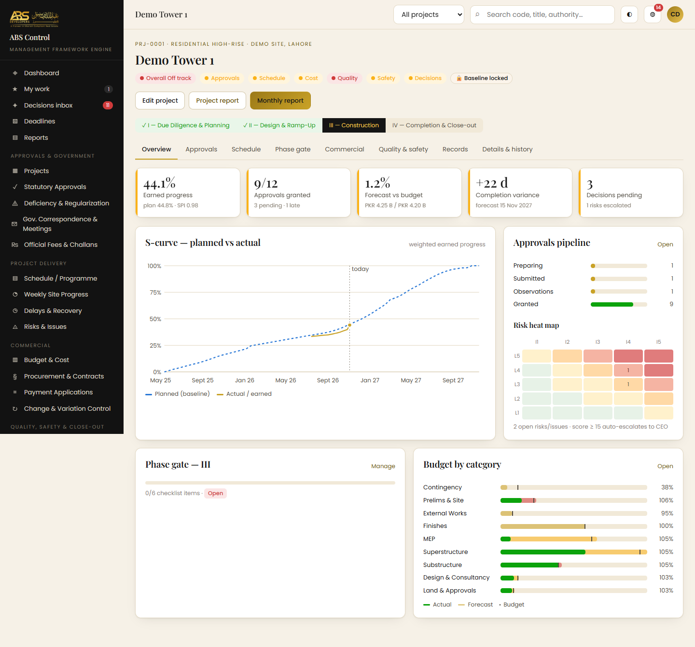 | 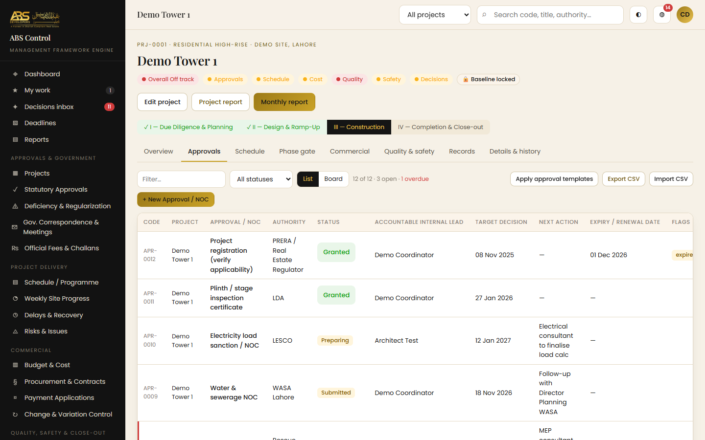 |
| Project overview: RAG chips, approvals pipeline, gate, budget | A project's statutory approvals |
| 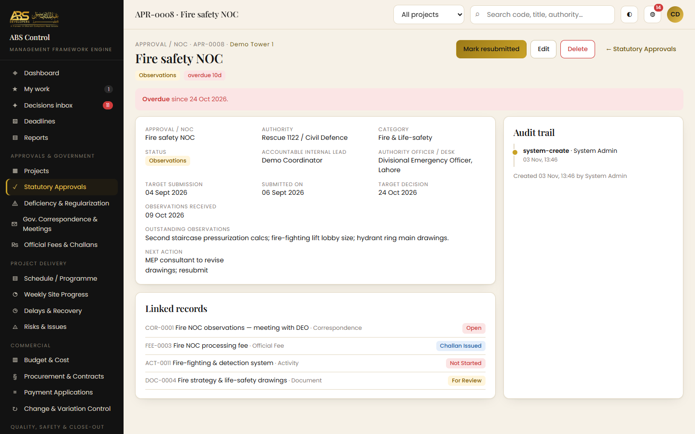 | 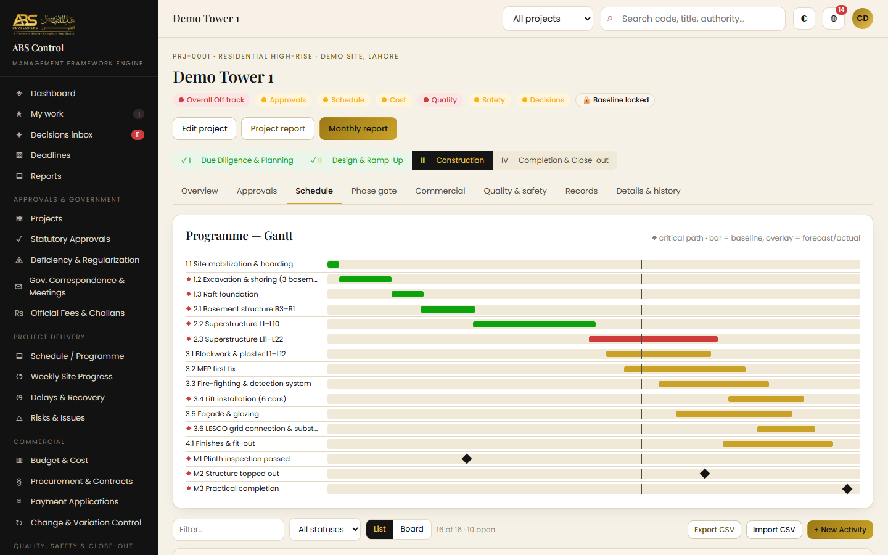 |
| An approval with observations, linked records and audit trail | Programme Gantt with critical path and slippage |
| 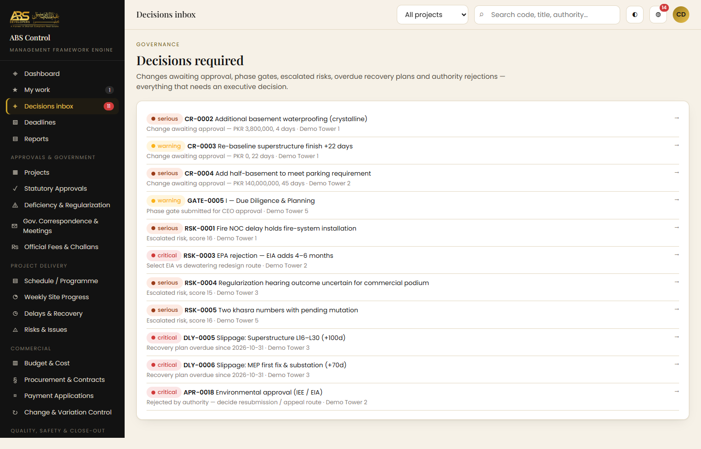 | 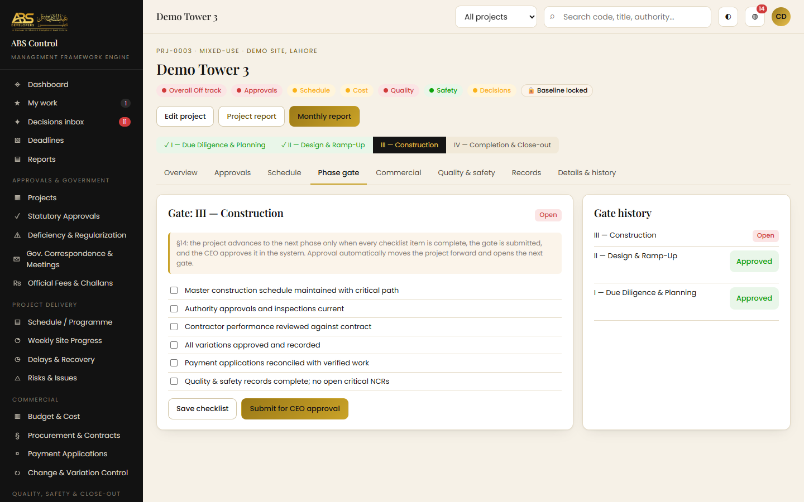 |
| Decisions inbox | Phase-gate checklist and CEO approval |
| 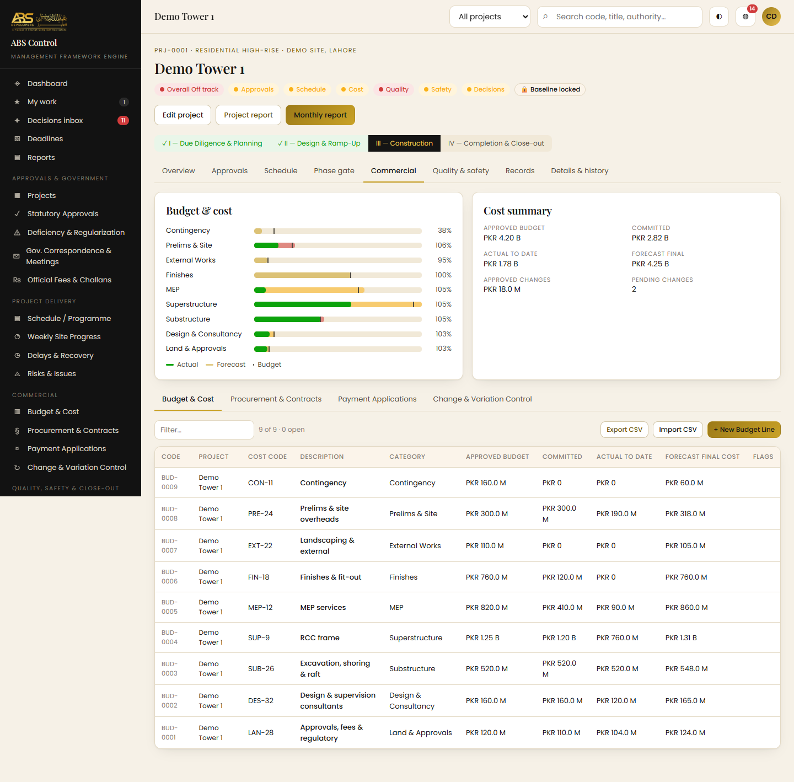 | 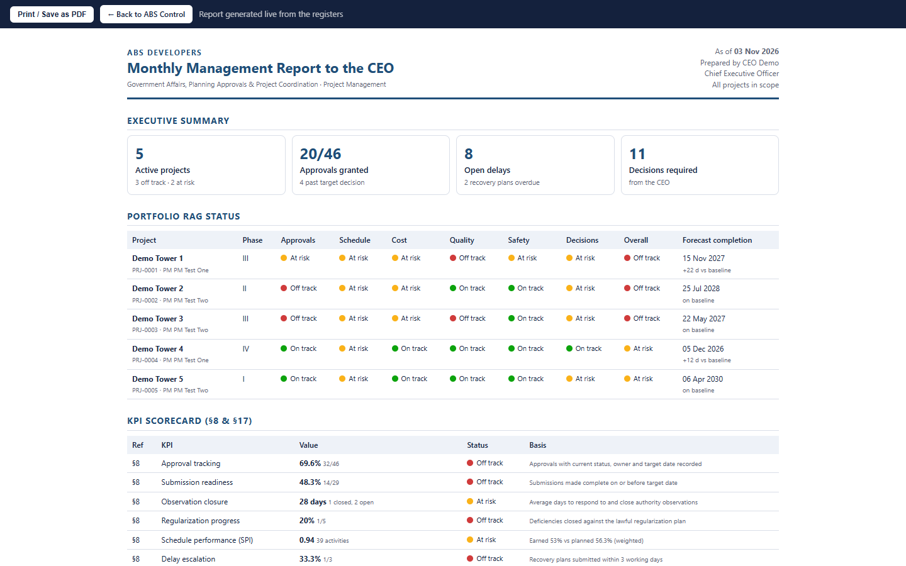 |
| Budget, commitments and forecast | Monthly report to the CEO |
| 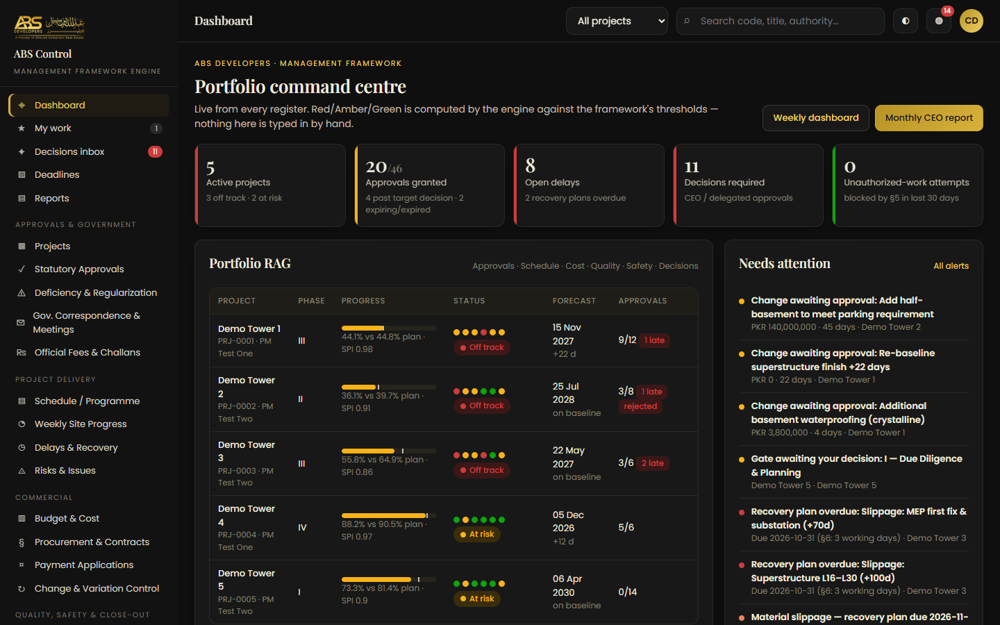 | 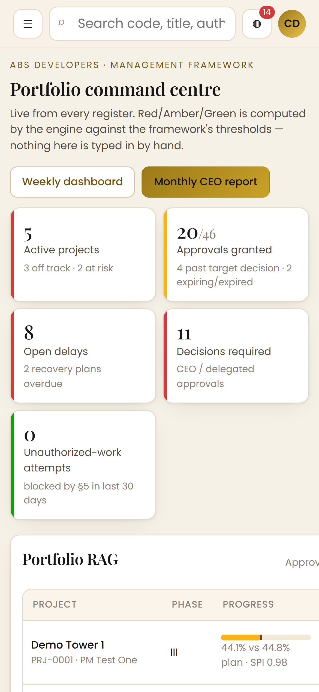 |
| Dark mode | Phone |

All screenshots show the app running locally with synthetic data: the seed's people, project and
vendor names were replaced with obviously fake ones ("Demo Tower 1", "PM Test One") in a copy
outside the repository before the screenshots were taken.

## Running it locally

```
git clone https://github.com/ashhhadd-210/abs-control.git
cd abs-control
node server.js            # http://localhost:4800
node server.js --seed     # wipe the database and reload the demo dataset
```

Node 22.5 or later is required for `node:sqlite`; there is nothing to install. On Windows,
`start.bat` does the same. The first start creates `data/` (git-ignored) and seeds a demo
portfolio of five projects across all four phases; the sign-in page lists the demo accounts.
Before real use, create real users as the administrator and disable the demo accounts.

Settings come from environment variables; there is no `.env` file:

| Variable | Purpose |
|---|---|
| `PORT` | HTTP port, default 4800 |
| `ABS_DATA` | Data directory for the database and uploads, default `./data` |
| `ABS_STORE` | `sqlite` (default) or `memory` (chosen automatically on Vercel) |
| `ABS_SECRET` | Session signing secret for the memory store; set it on any multi-instance host |
| `ABS_TZ` | Time zone for "today", default `Asia/Karachi` |

`npm run deploy` publishes the in-memory demo to Vercel through `scripts/deploy.js`. For durable
data, use a VPS or a container with a volume mounted at `/data`.
